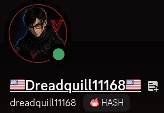
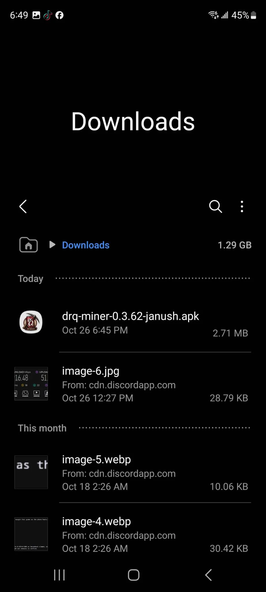
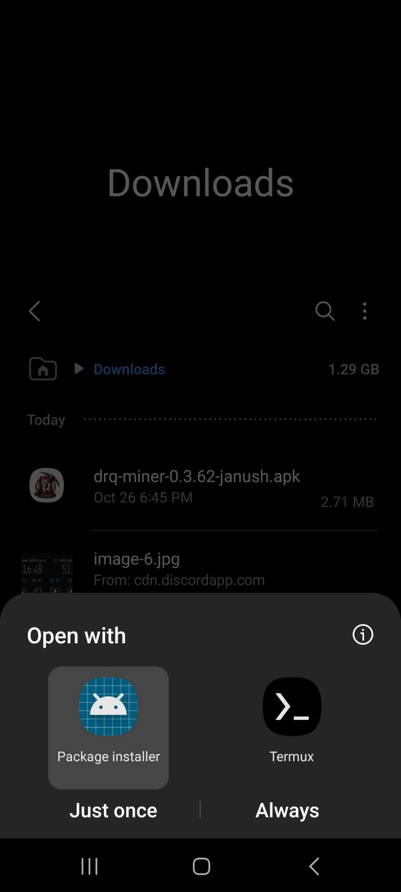
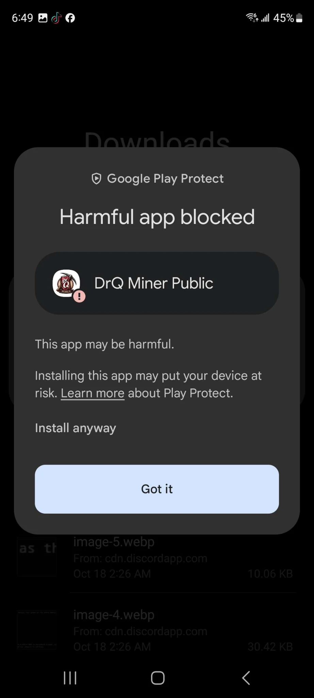
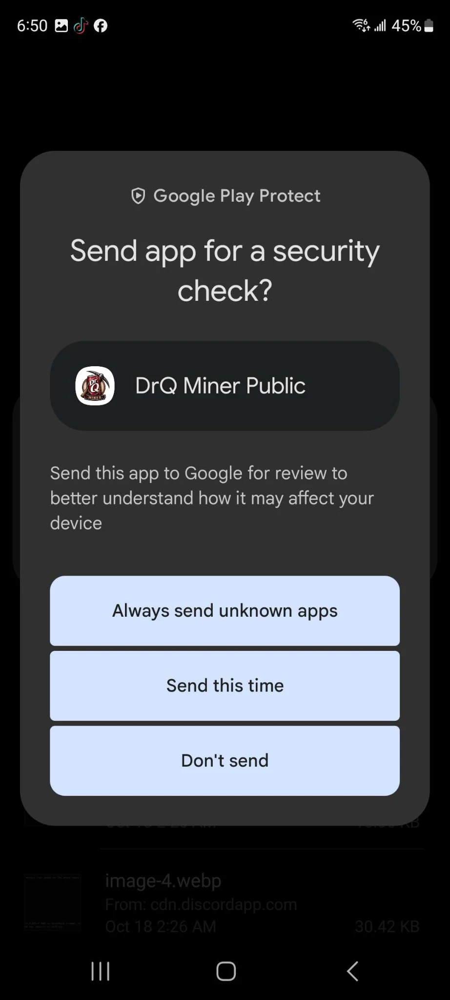
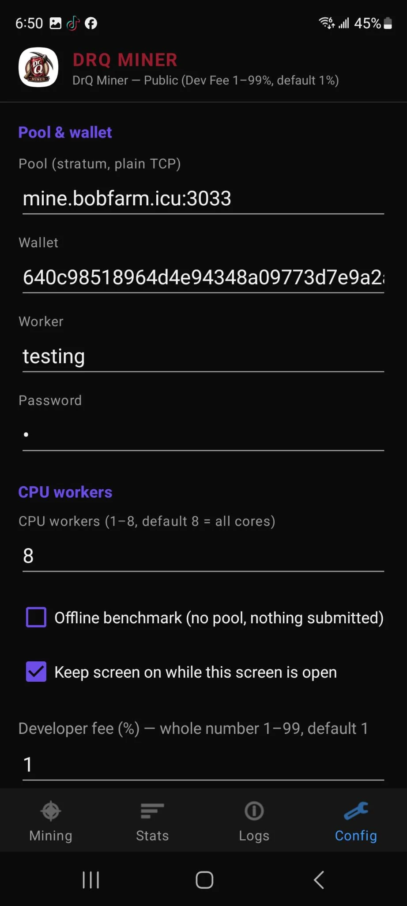
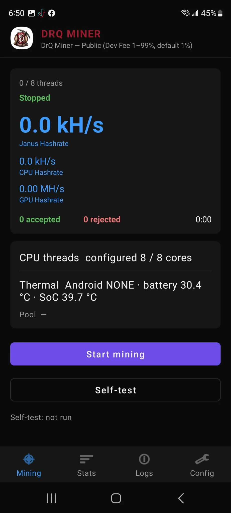
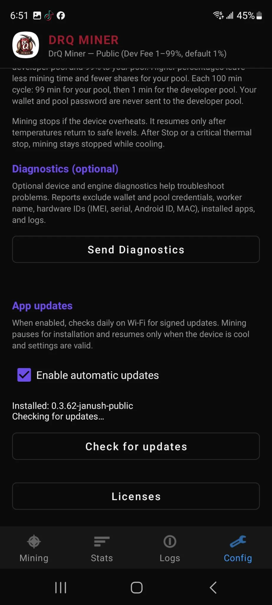

# Mobile Mining with DRQ Miner

This guide explains how to mine Warthog on an Android phone with **DRQ Miner**, a third party APK that mines Janushash (Proof of Balanced Work) using the APU of the device.

DRQ Miner is not a Warthog project. It is developed by Discord user [**dreadquill11168**](https://discord.com/users/815792695779786774) and distributed on [`DQMining/DRQ-Janus-Miner`](https://github.com/DQMining/DRQ-Janus-Miner).

!!!
Warning: DRQ Miner is **closed source** and is **not audited** by the Warthog team or by anyone else. Installing it means running an unknown binary with full access to your device. There is a real risk of malware, backdoors, unwanted software, or data exfiltration, and Google Play Protect flags the app as harmful.

- Install it on a **dedicated spare device**, never on the phone that holds your wallet seed or your everyday accounts.
- Download the APK **only** from the repository linked below, and only install the exact version you decided on.
- Expect Play Protect to complain. That complaint is a signal to think, not a hurdle to click through blindly.
- The developer has said he intends to open source the miner. Until that happens the APK stays closed source and unaudited, so the risks above remain.
!!!

!!!
Warning: The miner charges a **developer fee**. The fee is configurable from 1 to 99 percent and defaults to 1 percent. It works in a cycle: for every 100 minutes, 99 minutes of your mining time go to your pool and 1 minute goes to the developer pool. Your wallet address and pool password are never sent to the developer pool.

Set the fee to the lowest value you are willing to accept before you start mining.
!!!

## What you need

- An Android phone. More cores means more hashrate.
- A Warthog wallet address. You receive the mined coins there, so use your own wallet and not an exchange address.
- A mining pool. The steps below use [BOBFarm Pool](https://wart.bobfarm.icu/#/connect), which runs a low difficulty port intended for mobile miners.
- A phone charger and a way to keep the phone cool. Mining a phone nonstop will heat it up.

## Step 1: Open the APK on GitHub

Go to the DRQ Janus Miner repository and open the APK file:

[github.com/DQMining/DRQ-Janus-Miner](https://github.com/DQMining/DRQ-Janus-Miner/blob/main/drq-miner-0.3.62-janush.apk)

The file name carries the version, for example `drq-miner-0.3.62-janush.apk`. If the repository lists a newer build, you can pick it instead, but read the release notes and be aware that a newer build is a newer unknown binary.

## Step 2: Download the raw file

GitHub cannot show a preview for the file. Use the **Download raw file** button. Your browser may warn you that the file could be dangerous, which is expected for any APK.

## Step 3: Open the file with the package installer

After the download completed, open it from the Downloads folder and choose **Package installer**.

|  |  |
| :---: | :---: |
| The downloaded APK in the Downloads folder | Opening the APK with the package installer |

Android may ask you to allow installs from this source. If the phone belongs to a mining farm, allow it permanently. On a personal phone, allow it temporarily and turn the setting back off afterwards.

## Step 4: Get past Play Protect

When you tap install, Google Play Protect usually shows one of the two prompts below.

|  |  |
| :---: | :---: |
| The "Harmful app blocked" prompt | The "Send app for a security check?" prompt |

- On the "Harmful app blocked" screen, tap **Install anyway**.
- On the "Send app for a security check?" screen, tap **Don't send**.

Scanning the app with Play Protect is optional. In practice the miner is not distributed through the Play Store, so the scan usually offers nothing. Skipping it is faster, but it is your call, and understanding why the prompt appears matters more than clicking through it.

## Step 5: Configure the miner

The app opens on the Mining tab. Go to the **Config** tab and fill in the pool and wallet details.

| Field | What to enter |
|---|---|
| Pool (stratum, plain TCP) | The stratum host and port of your pool. BOBFarm Pool publishes a mobile friendly low difficulty port on its [connect page](https://wart.bobfarm.icu/#/connect), for example `mine.bobfarm.icu:3033`. |
| Wallet | Your Warthog wallet address. The miner credits the coins to this address. |
| Worker | A name for this device on the pool, for example your nickname or the farm name. It shows up in the pool statistics. |
| Password | The pool password, if your pool requires one. Many pools use `x` as a placeholder. |
| CPU workers | Number of threads, from 1 to 8. The default is 8, which is all cores. Lower it if the phone cannot keep up. |
| Offline benchmark | Runs a benchmark without connecting to a pool and submits nothing. Useful to check the hashrate of the device before mining. |
| Keep screen on while this screen is open | Keeps the display awake. Mining can stop when the screen turns off, depending on the device. |
| Developer fee (%) | The developer fee described above, from 1 to 99, default 1. |

The rest of the Config tab holds the diagnostics and update options, described further down.

## Step 6: Start mining

Go back to the **Mining** tab and tap **Start mining**.

The screen shows the state of the miner:

- **Janus Hashrate**, the effective hashrate of the device, plus the separate CPU and GPU hashrates.
- **Accepted** and **rejected** shares, and the running time.
- **CPU threads configured**, for example `8 / 8 cores`.
- **Thermal**, with the battery and SoC temperature, which is the number to watch.
- The pool the miner is connected to.

Below the numbers you also find a **Self-test** button, which runs the miner locally without a pool, and tabs for **Stats** and **Logs**.

## Thermal behaviour

Mining stops by itself if the device overheats, and it stays stopped until the temperatures come back down to a safe level. After a stop, either manual or thermal, mining remains stopped while the device cools.

In practice that means:

- Take the case off, or use a cooler stand, and keep the phone on a hard surface.
- Leave the phone plugged in, charging while it mines.
- Expect a phone to throttle or shut down mining during a hot day. Reduce the number of CPU workers if that happens constantly.

## Updates

The app can check for updates on its own. When the option is enabled, it checks daily over Wi-Fi for signed updates. Mining pauses while the update is installed and resumes only when the device is cool and the settings are still valid.

Use **Check for updates** to look for a new build manually. The version you are running is shown next to it, for example `Installed: 0.3.62-janush-public`.

## Diagnostics

The app can send a diagnostic report to the developer. The report excludes the wallet and pool credentials, the worker name, hardware identifiers such as IMEI, serial, Android ID and MAC, the installed apps, and the logs. It is optional and can be left alone.

## Links

- [DRQ Janus Miner GitHub repository](https://github.com/DQMining/DRQ-Janus-Miner)
- [BOBFarm Pool connect page](https://wart.bobfarm.icu/#/connect)
- [Mining calculator](https://wartscan.io/calculator)
- [Mining quick start guide](../quickstart/)
